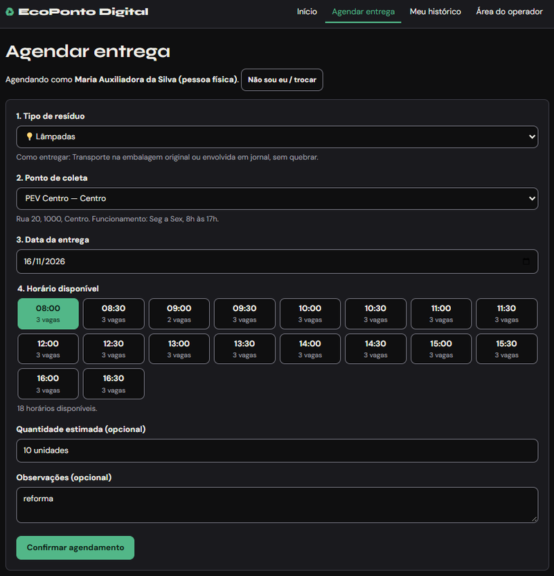
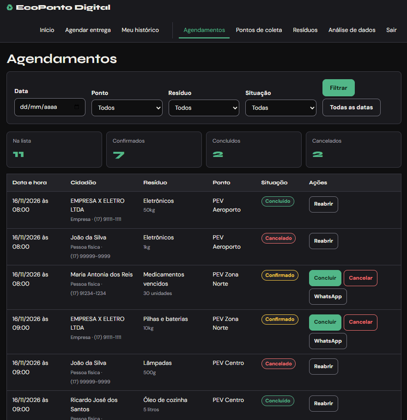
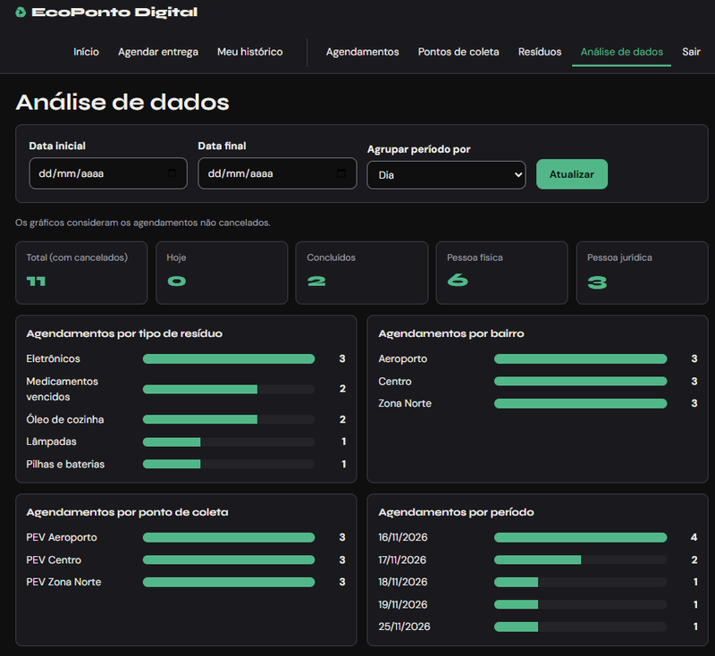
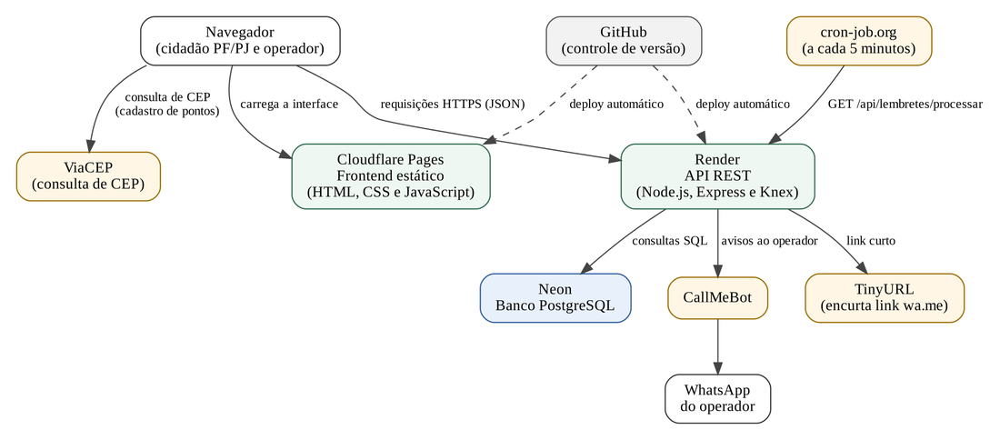

# ♻ EcoPonto Digital

Sistema web de **agendamento de entrega de resíduos especiais** (eletrônicos, pilhas e baterias, lâmpadas, medicamentos vencidos e óleo de cozinha) em pontos de entrega voluntária (PEV), para **pessoas físicas** e **empresas**, com painel de gestão e análise de dados para o **operador municipal**.

Projeto Integrador em Computação II — **UNIVESP**, Bacharelado em Tecnologia da Informação, polo Barretos/SP.

- 🌐 **Sistema no ar:** https://ecoponto-digital.pages.dev
- ⚠️ **Protótipo acadêmico:** os pontos de coleta cadastrados são **fictícios**, criados para demonstração.

## O problema

Pilhas, baterias, lâmpadas, eletrônicos, medicamentos vencidos e óleo de cozinha exigem descarte correto, e a Política Nacional de Resíduos Sólidos (Lei n. 12.305/2010) prevê a logística reversa desses itens. Para que ela funcione, o cidadão e a empresa precisam saber onde, quando e como entregar. Em municípios de médio porte, como Barretos/SP, falta um canal digital para agendar a entrega e registrar o que foi entregue.

## A solução

O cidadão (ou a empresa) escolhe o **tipo de resíduo**, o **ponto de coleta** (apenas os que o aceitam), a **data** e um **horário com vaga**, e recebe um comprovante com as instruções de descarte. O operador acompanha os agendamentos, gerencia pontos e resíduos e consulta gráficos.

| Agendamento | Painel do operador |
|---|---|
|  |  |



## Funcionalidades

**Cidadão (PF e PJ)**
- Cadastro adaptado ao perfil (PF: nome e CPF; PJ: razão social, CNPJ e responsável), com validação dos dígitos verificadores.
- Identificação por documento e telefone, sem senha.
- Agendamento em 4 passos, com grade de horários e vagas restantes.
- Comprovante com instruções de descarte e opção de impressão.
- Histórico de entregas; para empresas, comprovante para impressão ou PDF.

**Operador municipal**
- Login protegido (token HMAC-SHA256, validade de 8 horas).
- Agendamentos com filtros por data, ponto, resíduo e situação; ações de concluir, cancelar e reabrir; link de WhatsApp com a mensagem de lembrete pronta para o cidadão.
- Gestão de pontos de coleta (dias, horários, capacidade, resíduos aceitos), com endereço preenchido pela API **ViaCEP**.
- Gestão de tipos de resíduo.
- Análise de dados: gráficos por resíduo, bairro, ponto e período.
- Avisos no WhatsApp (via CallMeBot) a cada novo agendamento e lembretes cerca de 1 hora antes e cerca de 15 minutos antes do horário marcado.

## Regras de negócio (validadas no servidor)

- O ponto precisa estar ativo e aceitar o resíduo escolhido.
- Não é possível agendar em data ou hora passada (fuso de Brasília, UTC-3).
- O horário precisa existir na grade do ponto (dia da semana, abertura, fechamento e duração).
- Cada horário tem capacidade máxima de entregas; ao lotar, é recusado. Cancelar libera a vaga.
- Empresas precisam informar a quantidade estimada.
- O mesmo usuário não pode ter dois agendamentos ativos no mesmo ponto e horário.

## Tecnologias

| Camada | Tecnologia |
|---|---|
| Frontend | HTML, CSS e JavaScript puro |
| Backend | Node.js, Express e Knex |
| Banco local | SQLite (better-sqlite3) |
| Banco em produção | PostgreSQL (Neon) |
| Hospedagem do frontend | Cloudflare Pages |
| Hospedagem do backend | Render |
| API externa | ViaCEP |
| Notificações | CallMeBot (WhatsApp) e TinyURL (link curto) |
| Agendador | cron-job.org |
| Testes | Jest e Supertest |
| Acessibilidade | WCAG 2.1 nível AA (auditoria com Lighthouse) |
| Controle de versão | Git e GitHub |

## Arquitetura



## Estrutura do repositório

```
ecoponto-digital/
├── frontend/
│   ├── index.html
│   ├── css/style.css
│   └── js/ (api.js, auth.js, app.js)
├── backend/
│   ├── server.js
│   ├── database.js            # schema, seed e conexão (SQLite ou PostgreSQL)
│   ├── middleware/auth.js     # autenticação do operador
│   ├── routes/                # usuarios, pontos, residuos, agendamentos, lembretes, analise, auth
│   ├── utils/                 # validacao.js, callmebot.js
│   └── tests/                 # testes Jest
└── docs/img/                  # imagens deste README
```

## Como executar localmente

Requisitos: **Node.js 18 ou superior**.

```bash
git clone https://github.com/henriquet87-stack/ecoponto-digital.git
cd ecoponto-digital/backend
npm install
npm start
```

Abra http://localhost:3000. Sem `DATABASE_URL`, o servidor usa **SQLite** (arquivo `backend/ecoponto.db`, criado e populado automaticamente com 5 tipos de resíduo e 3 pontos fictícios de Barretos).

Em desenvolvimento, quando `APP_USER` e `APP_PASSWORD` não estão definidos, o login do operador usa os valores padrão **`admin`** / **`admin123`**. Isso vale **apenas localmente**: em produção essas variáveis são obrigatórias.

## Variáveis de ambiente

Os valores nunca vão para o repositório (o `.env` está no `.gitignore`).

| Variável | Para que serve | Obrigatória em produção |
|---|---|---|
| `DATABASE_URL` | Conexão PostgreSQL (Neon). Se ausente, usa SQLite. | Sim |
| `APP_USER` | Usuário do operador | Sim |
| `APP_PASSWORD` | Senha do operador | Sim |
| `SESSION_SECRET` | Segredo para assinar o token do operador | Sim |
| `OPERADOR_TELEFONE` | Número que recebe os avisos (formato 55DDDNÚMERO) | Para notificações |
| `CALLMEBOT_APIKEY` | Chave do CallMeBot do número acima | Para notificações |
| `DB_FILE` | Arquivo SQLite alternativo (usado nos testes) | Não |

## Testes

```bash
cd backend
npm test
```

São **45 testes automatizados** (12 unitários e 33 de integração), executados sobre um banco SQLite temporário, sem tocar na produção e sem enviar mensagens. Cobrem a validação de CPF, CNPJ, telefone e datas, o cadastro, a geração de horários, as regras de agendamento, a capacidade por horário e o controle de acesso do operador.

Acessibilidade: a auditoria com o Lighthouse registrou **100** na categoria Accessibility nas telas de início e de identificação, e aprovou todas as auditorias de acessibilidade nas telas de agendamento e do painel do operador.

## Implantação

- **Banco:** projeto no Neon; as tabelas são criadas na primeira inicialização do servidor.
- **Backend (Render):** *Root Directory* `backend`, *Build Command* `npm install`, *Start Command* `npm start`, com as variáveis de ambiente acima.
- **Frontend (Cloudflare Pages):** *Build output directory* `frontend`, sem comando de build. Defina a URL do backend em `frontend/js/api.js` (`API_PRODUCAO`).
- **Lembretes:** um job no cron-job.org chama `GET /api/lembretes/processar` a cada 5 minutos, o que também mantém ativo o serviço do plano gratuito.

## Limitações e próximos passos

- As notificações vão para o **operador**, e não diretamente para o cidadão: o CallMeBot só envia mensagens a números que ativaram uma chave de API. O envio direto exigiria a API oficial do WhatsApp Business.
- A identificação do cidadão por documento e telefone **não é uma autenticação forte**.
- A checagem de capacidade conta as vagas antes de inserir; requisições simultâneas para a última vaga poderiam excedê-la em uma unidade.
- Os pontos de coleta são fictícios e o sistema não foi submetido a uma avaliação de uso com usuários.
- Próximos passos: autenticação do cidadão, reagendamento e cancelamento pelo próprio cidadão, parceria com a prefeitura para cadastrar os pontos reais e avaliação de usabilidade.

## Autor

**Thiago Henrique da Silva** — RA 24217077 — UNIVESP, polo Barretos/SP
Orientador: Gabriel Henrique Braga Marinelo

Projeto desenvolvido para fins educacionais.
